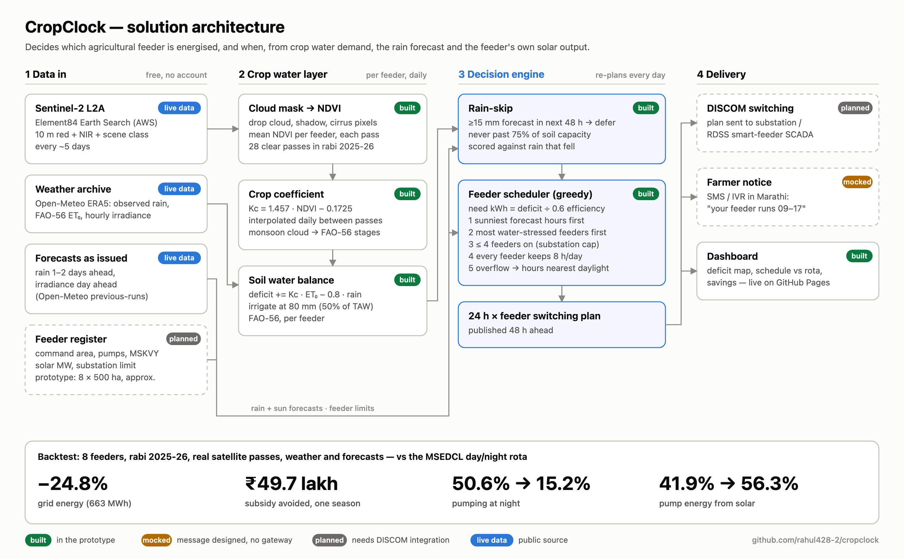

# CropClock

Solar-aligned, crop-aware scheduling for agricultural electricity feeders.
Schneider Electric Yuva Yodha Energy Tech Hackathon 2026 — Challenge 01, Sustainable Agriculture.

**Live dashboard:** https://rahul428-2.github.io/cropclock/prototype/

India's agricultural feeders run on a fixed rota that ignores rain, crop stage and the feeder's
own solar plant. CropClock decides which feeder is energised, and when, from three inputs:

1. **Crop water demand from satellite** — Sentinel-2 NDVI per feeder command area → crop coefficient → FAO-56 water balance.
2. **Rain-skip** — irrigation is deferred when the forecast issued 1–2 days ahead says ≥15 mm is coming.
3. **Feeder scheduler** — greedy: sunniest forecast hours first, most water-stressed feeders first, a 4-feeder substation cap, and every feeder keeps its 8 h/day.



## Results — 8 feeders × 500 ha, west of Solapur, Maharashtra

| | Rabi 2025-26 | Kharif 2025 |
|---|---|---|
| Grid energy avoided vs MSEDCL rota | 663 MWh (−24.8%) | 747 MWh (−17.8%) |
| Subsidy avoided (₹7.5/kWh) | ₹49.7 lakh | ₹56.0 lakh |
| Pumping at night | 50.6% → 15.2% | 49.0% → 16.9% |
| Pump energy from feeder solar | 41.9% → 56.3% | 38.6% → 47.7% |

Rabi uses Sentinel-2 crop demand and an ET-optimal farmer (no behavioural assumption). Kharif is
cloud-blocked for optical satellites, so it uses the FAO-56 soybean stage calendar and a defensive
farmer (60 mm every 12 days). In kharif, 31 irrigations were deferred for rain and rain followed in all 31.

## Run it

```sh
python3 -m venv .venv && . .venv/bin/activate
pip install numpy rasterio pystac-client matplotlib
cd prototype
python ndvi.py            # Sentinel-2 → out/ndvi.json + out/ndvi/*.png  (~5 min)
python cropclock.py       # weather + forecasts + 3 strategies → out/sim.json
python test_cropclock.py  # scheduler checks
python -m http.server     # open http://localhost:8000
```

All data is free and needs no account: Sentinel-2 L2A via Element84 Earth Search, observed weather
from the Open-Meteo ERA5 archive, archived forecasts from the Open-Meteo previous-runs API.

## Layout

- `prototype/` — round-2 prototype: `ndvi.py`, `cropclock.py`, dashboard `index.html`, outputs in `out/`
- `analysis/` — round-1 single-feeder backtest (`backtest.py`, `RESULTS.md`); constants shared with the prototype
- `docs/` — design spec, architecture diagram (`architecture.png` / `.pdf`, generated by `architecture.py`)
- `round1/` — round-1 deck and description

## Limits

Feeder command areas are approximated as 500 ha squares; DISCOMs hold the real feeder-to-field
mapping. Results are feeder-level aggregates, never plot-level claims.

Team: Rahul Varma, Manjith Reddy, Karthik Somisetty.
